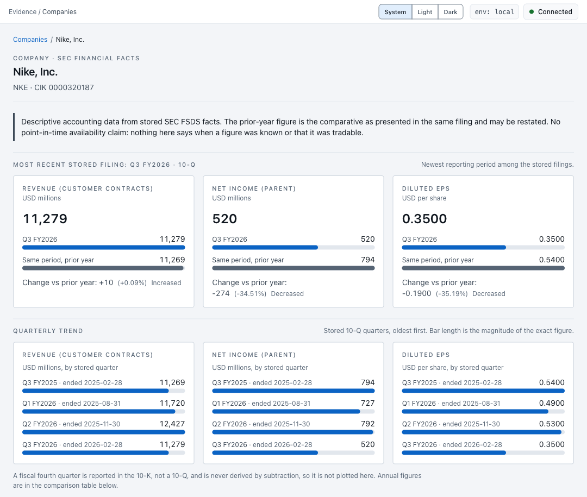
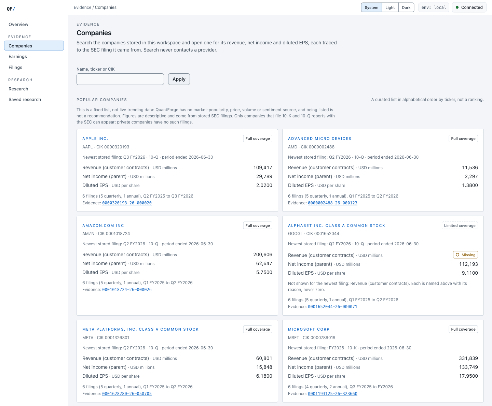
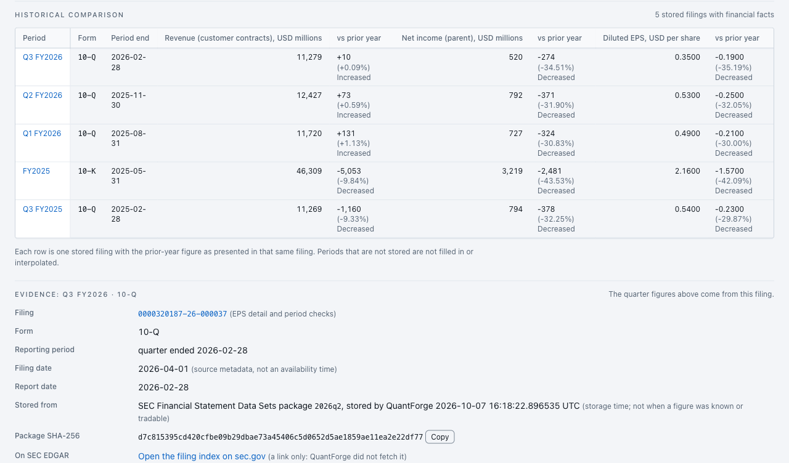

# QuantForge

A local, read-only equity research workstation: provenance-tracked market data, SEC filings and financial facts, an
earnings event-study engine, and a Next.js interface to browse them. It is **not a trading system**. There is no
strategy, order, fill, position or P&L model, and every API route is a `GET`.



*A company page: the most recent stored filing beside its prior year, and the stored quarters as a trend. This is the
Nike demonstration dataset ([how to run it](#view-the-nike-demo)).*



*Search stored companies by name, ticker or CIK.*



*Every figure traces to a filing: the comparison table across stored filings, then the filing, its data-set package and
SHA-256 (the exact stored facts follow below it on the page).*

## What it does today

- **Companies** (`/companies`): search stored companies and open one for revenue, net income and diluted EPS by
  period, each with the filing, the SEC data-set package and the exact stored facts behind it.
- **Earnings, Filings and Research**: earnings events, the FSDS-backed filings index with per-filing EPS (current,
  comparative as presented, change), a research workspace (event alignment, EPS surprise, forward and abnormal
  returns) and immutable, verifiable saved research records.
- **Ingestion CLI** (`quantforge`): reference data, daily bars, benchmark levels and splits from Massive; earnings
  from Finnhub; SEC filing identity and acceptance metadata; accession-bound financial facts from a **local** SEC FSDS
  ZIP. Every run is recorded, raw responses are kept content-addressed, and writes are idempotent.
- **Read-only API** (FastAPI) with exact-decimal strings, named refusal statuses instead of guesses, and health and
  readiness probes.

What does **not** exist: a trading strategy, orders, fills, P&L, corporate-action share-count handling,
authentication, or any write through the API. Put the API on a private network or behind an authenticating proxy.

## Prerequisites

| Tool     | Version used | Notes                                                    |
| -------- | ------------ | -------------------------------------------------------- |
| Python   | 3.14         | managed with `uv`; pinned in `apps/api/.python-version`   |
| uv       | 0.12+        | dependency and environment manager                       |
| Node.js  | 24           | the version CI uses; install it yourself (the repository ships no installer) |
| Docker   | any recent   | Docker Desktop or any Compose v2+ implementation         |

## Quick start (ordinary development)

This uses the **`quantforge`** database. It starts empty, and nothing here fills it.

```bash
# 1. Infrastructure (PostgreSQL + Redis, loopback only)
cp .env.example .env
docker compose up -d
docker compose ps

# 2. Backend dependencies and schema (an explicit step: nothing migrates on its own)
cd apps/api
uv sync --all-groups
uv run alembic upgrade head          # the current head is 0014

# 3. Backend (http://localhost:8000)
uv run uvicorn quantforge.main:app --reload

# 4. Web, in a separate terminal (http://localhost:3000)
cd apps/web
npm install
npm run dev
```

The web app reads the API at `NEXT_PUBLIC_API_BASE_URL` (default `http://localhost:8000`; see
`apps/web/README.md`). Check the backend with:

```bash
curl -s localhost:8000/health              # liveness: the process answers HTTP (touches nothing else)
curl -s localhost:8000/api/v1/health/ready # readiness: database reachable AND schema exactly at head
```

An empty database is served honestly: every page says nothing is stored. **Companies will be empty** (it lists only
companies stored by reference ingestion), and a company without financial facts shows "No SEC financial data is stored
for this company". That is expected, not a fault. Data arrives only through the [ingestion commands](#ingestion-at-a-glance),
which need provider keys or a local SEC data-set ZIP. Nothing copies the Nike demo data into this database.

## View the Nike demo

The only populated example is **Nike**, in a separate **`quantforge_validation`** database. It must **already exist**,
at revision `0014`, holding the previously ingested records. Starting the server does not create or populate it, and
there is no supported from-scratch rebuild that avoids ingesting SEC data. With the Docker services up
(`docker compose up -d`), from the repository root:

```bash
# Terminal 1: the real API against the validation database (read-only; 127.0.0.1:8000, or pass another port)
uv run --project apps/api python scripts/validation/serve.py 8000
curl -s localhost:8000/api/v1/health/ready      # expect "status":"ready"

# Terminal 2: the web app, pointed at that API
cd apps/web
npm install
NEXT_PUBLIC_API_BASE_URL=http://127.0.0.1:8000 npm run dev
```

Open <http://localhost:3000/companies?q=nke>, then the Nike link (`/companies/0000320187`). `serve.py` takes its
connection from the application's default local settings with only the database name replaced, and prints no
credential. For a production build set the same variable for both steps, because the address is fixed into a build:
`NEXT_PUBLIC_API_BASE_URL=http://127.0.0.1:8000 npm run build`, then the same prefix on `npm run start`.

The demo depends on facts stored earlier from the SEC Financial Statement Data Sets packages `2025q2`, `2025q3`,
`2025q4` and `2026q2`. Those names are provenance only, not instructions to fetch anything.

## Companies

`/companies` searches stored companies by name substring, exact current ticker or CIK. `/companies/[cik]` shows, for
one company: financial **cards** for the most recent stored filing, a **Quarterly trend**, a **Historical comparison**
table, and an **Evidence** section per filing. It is read-only, and opening a page makes no provider or SEC request.
The routes are `GET /api/v1/companies?q=&limit=&offset=` and `GET /api/v1/companies/{cik}/financials` (`404` only for an
unknown CIK; refusals inside a response are `200` with a named status).

| Shown as | Meaning |
|---|---|
| Revenue (customer contracts) | the single concept `RevenueFromContractWithCustomerExcludingAssessedTax`. For a bank or insurer it can be **only a subset** of total revenue. |
| Net income (parent) | the single concept `NetIncomeLoss`, the parent-company figure under the current selector. |
| Diluted EPS | the existing frozen EPS selectors (`EarningsPerShareDiluted`, USD per share). |

- **Quarterly and annual are separate.** A 10-Q is read as one quarter (`qtrs` 1) and a 10-K as one year (`qtrs` 4).
  Year-to-date amounts are never used as a quarter. The quarterly trend plots only stored 10-Q quarters and never
  derives a missing Q4; annual figures appear in the comparison table. Bar length shows the magnitude of the exact
  value (a loss is a negative label, not a different bar).
- **Prior-year comparison** is the comparative **as presented in the same filing** (it may be restated), found only
  at exactly 12 month-ends earlier with the same duration. Anything else (including 52/53-week calendars) is a named
  refusal such as `PERIOD_MISMATCH`, `MISSING`, `AMBIGUOUS` or `WRONG_UNIT`, never an invented number. Only
  non-dimensional USD facts of the standard us-gaap taxonomy qualify; an issuer extension is never mapped.
- **Evidence.** Each figure is an exact stored fact (tag, taxonomy version, unit, period end, duration, exact value).
  Each filing shows its accession (linking to the filing page), the form, filing and report dates, the SEC data-set
  package it was stored from with that package's **SHA-256** (which identifies the exact bytes ingested; it says
  nothing about licensing), and an sec.gov filing-index link that is **derived from the CIK and accession and never
  fetched by QuantForge**. "Stored by QuantForge" is storage time. Filing and report dates are source metadata. The SEC
  acceptance time is not shown and, like these dates, is not when a figure became available: the page makes no
  point-in-time claim.
- **Coverage is whatever is stored.** The Nike dataset holds five filings: Q3 FY2025, the FY2025 10-K, Q1 FY2026,
  Q2 FY2026 and Q3 FY2026. It is not a general multi-company dataset.

## Architecture

```
apps/
├── api/      FastAPI service (read-only), SQLAlchemy/Alembic, the `quantforge` ingestion CLI, research engine
└── web/      Next.js interface; every API read happens on the server
docs/         design records, operations runbook, implementation notes
scripts/      release smoke and the validation harness
```

Python 3.14 with FastAPI, SQLAlchemy 2 and Alembic on PostgreSQL 18 (Redis 8 is reported but never required to serve);
Next.js 16, React 19 and Tailwind 4 on the web side. Rules that shape the code:

- **Facts carry provenance, not availability.** Accession-bound SEC facts record the filing and package they came
  from. Nothing implies when a fact was publicly known, and `accepted_at` never reaches an API.
- **Exact decimals end to end.** Money is `NUMERIC`/`Decimal`, serialised as fixed-point strings and never converted
  to a JavaScript number for display.
- **Raw evidence is kept.** Provider responses and FSDS packages are stored byte-for-byte, content-addressed by SHA-256.
- **Refuse rather than guess.** Selectors return a named status (`MISSING`, `AMBIGUOUS`, `WRONG_UNIT`, ...) instead of
  choosing a value.
- **Research modes never mix.** Descriptive and point-in-time analyses are separate; prices are split-adjusted, not
  total-return, and the one benchmark, SPY, is an ETF proxy for the S&P 500.

The data, ingestion and research layers are described step by step in
[`docs/implementation-notes.md`](docs/implementation-notes.md).

### Ingestion at a glance

Run as `uv run quantforge <command>` from `apps/api`, after `uv sync --all-groups` and a migrated database. Each command
records an `ingestion_run`; a failed run rolls back and prints whether it is safe to retry.

| Command | Needs | What it stores |
|---|---|---|
| `ingestion reference TICKER...` | `QF_MASSIVE_API_KEY` | issuer, security and listing identity |
| `ingestion daily TICKER --start D --end D` | `QF_MASSIVE_API_KEY`, reference first | split-adjusted (or `--price-basis as-traded`) daily bars |
| `ingestion benchmark SYMBOL --start D --end D --name N` | `QF_MASSIVE_API_KEY` | benchmark levels with an explicit identity |
| `ingestion earnings TICKER --start D --end D` | `QF_FINNHUB_API_KEY`, reference first | earnings observations (revisions kept) |
| `ingestion sec-filings CIK` | `QF_SEC_USER_AGENT` | SEC filing **identity** (`accepted_at` stays NULL) |
| `ingestion sec-filing-acceptance ACCESSION [--verify]` | `QF_SEC_USER_AGENT` | one filing's `accepted_at`, from its official EDGAR header |
| `ingestion sec-fsds PACKAGE.zip --accession A` | a local FSDS ZIP, no network | accession-bound numeric facts |
| `ingestion runs [--status S] [--dataset D]` | database only | read-only run history with failure reasons |

`stock-splits`, `sec-filings-history` and the `listing-*` commands are described in the implementation notes. Provider
keys and the SEC identity are never needed to serve the product.

## Running the stack

### Infrastructure

Only two backing services are defined, both bound to loopback so nothing is
exposed to the network.

| Service    | Image       | Port    | Volume                 |
| ---------- | ----------- | ------- | ---------------------- |
| `postgres` | `postgres:18` | `5432` | `quantforge_postgres_data` |
| `redis`    | `redis:8`     | `6379` | `quantforge_redis_data`    |

```bash
docker compose up -d     # start (or resume) both services
docker compose ps        # status, health and published ports
docker compose logs -f   # follow logs
docker compose down      # stop and remove containers, KEEP the data volumes
```

> ### `docker compose down -v` deletes your local data
>
> ```bash
>
> docker compose down -v
> ```
>
> The `-v` flag removes the named volumes, which **permanently deletes the
> PostgreSQL cluster and all Redis keys** in this project. Every table, row and
> migration-applied schema is lost, and the next `docker compose up -d` starts
> from a brand-new, empty database. Use it only when you intend a clean slate.

Credentials come from the environment. `.env` is git-ignored; only
`.env.example` is committed.

### Migrations

Run from `apps/api`:

```bash
uv run alembic upgrade head            # apply everything (always an explicit, deliberate step)
uv run alembic current                 # which revision is applied (the head is 0014)
uv run alembic current --verbose       # ...with its description
uv run alembic history                 # full lineage
uv run alembic check                   # fail if models have drifted from the DB
uv run alembic revision --autogenerate -m "describe the change"
```

`alembic.ini` deliberately contains **no database URL**. `alembic/env.py` reads
`QF_DATABASE_URL` from the application `Settings`, so migrations always target
the same database as the API and no credential is ever committed. Autogenerate
compares against `Base.metadata`; `alembic check` fails if the models have
drifted from the applied schema, and the test suite runs it as a gate. The API refuses to
call itself ready on any other revision than its own single head (see below), and it never migrates.

Lineage: the empty `0001`; the financial domain (`0002`); ingestion runs / issuer CIK (`0003`);
earnings persistence (`0004`) and the `event_date`/`event_timestamp` correction (`0005`); explicit price
basis (`0006`); the availability basis on earnings events (`0007`); SEC filing metadata (`0008`); stock
splits with coverage (`0009`); sourced listing history (`0010`); accession-bound financial facts (`0011`);
verbatim FSDS `accepted` text (`0012`); saved research records and the benchmark-bar run link (`0013`);
and `sec_filing.accepted_at` made nullable (`0014`, current head).

> **`0014` cannot be downgraded once SEC filings are ingested.** Bulk SEC ingestion stores
> `accepted_at = NULL` by design ("exact instant not established"), and the downgrade refuses while any such
> row exists rather than invent an instant. After SEC ingestion, rolling back means **restoring the
> pre-migration backup**, not `alembic downgrade`. See the runbook.

The research, signal, and backtest layers are all computed, not persisted (except saved research records).

### Health endpoints

| Endpoint                   | Answers                                              | Gates on                              | On failure |
| -------------------------- | ---------------------------------------------------- | ------------------------------------- | ---------- |
| `GET /health`, `GET /api/v1/health` | is the process answering HTTP?               | nothing (queries no datastore, no migration, no provider) | n/a |
| `GET /api/v1/health/ready` | can this binary serve its contract against its infrastructure? | PostgreSQL **and** schema = this binary's migration head | `503`, typed body |

Liveness stays `200` with every datastore stopped: use it for container probes. Readiness is `200` only
when PostgreSQL answers a bounded query **and** the database's Alembic revision equals the binary's single
head exactly (behind, ahead, missing or ambiguous revisions are all `503`; nothing is ever migrated or
repaired by the probe). **Redis is reported but never gates** (`gating: false`): no serving path uses it,
so a Redis outage does not take the product out of rotation. Providers (Massive, Finnhub, SEC) are never
probed. A future feature that makes Redis part of serving must make it gating in the same change.

```json
{
  "status": "ready",
  "service": "quantforge-api",
  "dependencies": {
    "database": { "state": "ok", "gating": true },
    "redis": { "state": "unavailable", "gating": false }
  },
  "schema": { "state": "compatible", "expected": "0014", "current": "0014", "gating": true },
  "detail": { "redis": "ConnectionError" }
}
```

`state` values: database `ok | unavailable`; redis `ok | unavailable | not_configured`; schema
`compatible | mismatch | unknown`. `detail` reports exception class names only. Passwords, DSNs, hosts,
SQL, paths, stack traces and driver messages are never **returned**, and an expected outage is logged as
one concise line of class names only. An unexpected programming error inside a probe keeps its traceback
in the server log by design.

### Operations

`docs/operations-runbook.md` covers the deploy order (backup, deploy, explicit migration, liveness,
readiness, smoke), the `0014` rollback caveat, provider outages, failed ingestion, backup and restore, and
the release smoke (`npm run smoke:release` from `apps/web`, or `node scripts/release-smoke.mjs`).

## Tests and validation

```bash
# Backend (from apps/api)
uv run pytest -m "not integration" -q       # unit tests; no database needed
uv run ruff check . && uv run ruff format --check .
uv run mypy

# Frontend (from apps/web)
npm run lint
npm run typecheck
npm run test                                # vitest
npm run contract:check                      # backend schema, OpenAPI snapshot and generated types agree
npm run build
npm run e2e                                 # fixture-backed browser tests (production build + a stand-in API; no database)
```

**Integration tests need care.** `uv run pytest` with no filter also runs the `integration` tests whenever a
PostgreSQL server is reachable. They create and drop their own throwaway databases (`quantforge_test` and a scratch database for the migration tests;
never the development or validation database). Run `uv run pytest -m integration -q` deliberately, and use
`-m "not integration"` otherwise. Release qualification and the read-only release smoke are in
[`docs/operations-runbook.md`](docs/operations-runbook.md).

## Troubleshooting

| Symptom | Cause | Fix |
|---|---|---|
| The web app says "Cannot reach the QuantForge API", or `curl localhost:8000/api/v1/health/ready` fails or returns `503` with the database `unavailable` | Docker or PostgreSQL is not running (liveness, `/health`, stays `200` even then) | `docker compose up -d`, then `docker compose ps` until both services are healthy |
| `/api/v1/health/ready` returns `503` with a schema `mismatch` | The database is not at this version's Alembic head (`0014`). The API never migrates | From `apps/api`: `uv run alembic current`, then `uv run alembic upgrade head` against the database you mean to migrate. Read the `0014` downgrade caveat under [Migrations](#migrations) first |
| `/companies` is empty, or a company says "No SEC financial data is stored for this company" | You are on the ordinary development database (`quantforge`), which has no financial facts and is not populated automatically | To see data, run the Nike demo against the **separate** `quantforge_validation` database ([View the Nike demo](#view-the-nike-demo)). That database must already exist; starting a server does not create or fill it. Otherwise ingest data with the [ingestion commands](#ingestion-at-a-glance) |
| The web app still talks to the old API address after you changed `NEXT_PUBLIC_API_BASE_URL` | `next build` fixes the address into the build | Set the variable for the build: `NEXT_PUBLIC_API_BASE_URL=http://127.0.0.1:8000 npm run build`, then `npm run start`. `npm run dev` reads it each time it starts |
| `uv run pytest` talks to PostgreSQL and creates or drops databases | With no filter it also runs the `integration` tests whenever PostgreSQL is reachable | Use `uv run pytest -m "not integration" -q`; run `uv run pytest -m integration -q` only deliberately |

## Known limitations

- **Scope:** research and display only. No trading, orders, fills, P&L or authentication, and the release candidate
  (`v0.1.0-rc.1`) is not a production deployment.
- **Companies coverage:** only Nike has facts, for five periods; the fiscal Q4 and anything after Q3 FY2026 are not
  stored. Revenue and net income are single concepts, **not comprehensive accounting coverage** for every industry (for
  example noncontrolling-interest income, or total revenue for financials, is not shown).
- **Amendments and size:** a 10-Q/A or 10-K/A is its own row and the trend does not de-duplicate an amended quarter. A
  company page reads at most its 40 newest stored filings.
- **Not point-in-time:** FSDS facts and SEC acceptance times are descriptive provenance, not evidence of when a figure
  was available, so no current earnings row is point-in-time eligible.
- **Verification gaps:** the two Companies SQL reads (directory search and per-company filing query) have no
  database-level automated test, and no end-to-end test covers `/companies`; both were checked manually only. Under
  `next dev`, the unknown-CIK page (and the older unknown-event page `/earnings/<id>`) stayed on its loading skeleton
  in a browser although the server HTML held the correct content, while the dev server's hot-reload websocket also
  reported errors; the cause is not established. On a production build both rendered correctly with no console errors.
- **Provider limits:** Massive's Benzinga earnings endpoint is entitlement-blocked (`403`), so Finnhub supplies the
  earnings calendar; the live Massive probes for splits and listing history are outstanding.

## Documentation

- [`apps/web/README.md`](apps/web/README.md): the web app, routes, configuration and browser tests.
- [`apps/api/README.md`](apps/api/README.md): API configuration, schema conventions, ingestion and backend tests.
- [`docs/implementation-notes.md`](docs/implementation-notes.md): layer-by-layer notes on ingestion, FSDS facts, EPS selection and research.
- [`docs/operations-runbook.md`](docs/operations-runbook.md): deployment, rollback, backup and the release smoke.
- [`docs/release-qualification-12e.md`](docs/release-qualification-12e.md) and
  [`docs/release-candidate-hardening-design.md`](docs/release-candidate-hardening-design.md): the release candidate record.
- [`docs/production-validation-design.md`](docs/production-validation-design.md) and
  [`docs/sec-acceptance-time-design.md`](docs/sec-acceptance-time-design.md): the validation database and SEC acceptance-time decisions.
- [`docs/frontend-v2-design.md`](docs/frontend-v2-design.md): the **earlier** frontend design record (frozen); it still
  describes Companies as "reserved, not built", which is superseded by this README.
